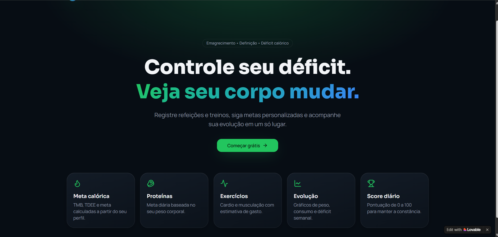
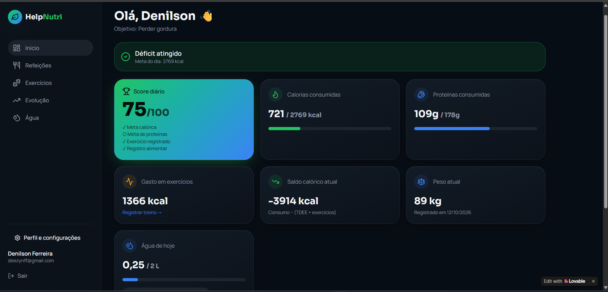
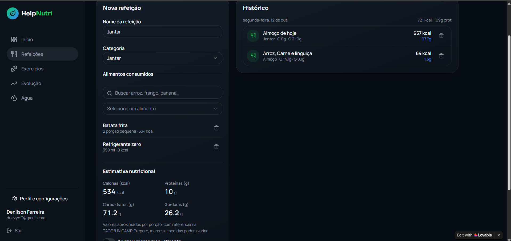
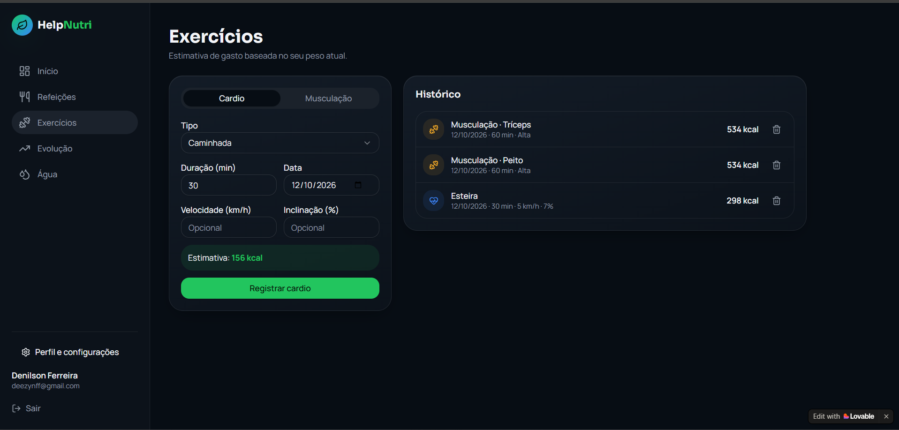

<div align="center">

# 🥗 HelpNutri 💪

**Acompanhamento nutricional, exercícios, hidratação e evolução corporal em um só lugar.**

Controle calorias, proteínas, treinos, água e progresso físico de forma simples, rápida e visual.

[](https://preview--pixel-perfect-display-0997.lovable.app/?__lovable_receipt=mat_2rmyev51gh8t4rss77fzh3dbn0)
[](https://github.com/DenilsonFerreiraDev/HelpNutri)


<br />



</div>

---

## 📑 Índice

- [Demonstração](#-demonstração)
- [Sobre o projeto](#-sobre-o-projeto)
- [Principais recursos](#-principais-recursos)
- [Screenshots](#-screenshots)
- [Funcionalidades em detalhe](#-funcionalidades-em-detalhe)
- [Tecnologias](#️-tecnologias-utilizadas)
- [Instalação local](#️-instalação-local)
- [Estrutura do projeto](#-estrutura-do-projeto)
- [Melhorias futuras](#-melhorias-futuras)
- [Autor](#-autor)
- [Licença](#-licença)

---

## 🚀 Demonstração

| | |
|---|---|
| 🌐 **Aplicação online** | [Acessar o HelpNutri](https://preview--pixel-perfect-display-0997.lovable.app/?__lovable_receipt=mat_2rmyev51gh8t4rss77fzh3dbn0) |
| 📂 **Repositório** | [github.com/DenilsonFerreiraDev/HelpNutri](https://github.com/DenilsonFerreiraDev/HelpNutri) |

---

## 📖 Sobre o projeto

O **HelpNutri** é uma aplicação web criada para quem quer **emagrecer**, **ganhar massa muscular** ou **manter uma alimentação equilibrada**, sem precisar entender de nutrição.

O sistema calcula automaticamente metas nutricionais personalizadas, acompanha exercícios, monitora a hidratação diária e registra a evolução corporal do usuário em dashboards intuitivos.

Em vez de exigir que você saiba os valores nutricionais de cada alimento, basta informar o que comeu e o HelpNutri estima automaticamente:

- 🔥 Calorias
- 🥩 Proteínas
- 🍞 Carboidratos
- 🥑 Gorduras

Tudo em uma interface moderna, escura (Dark Mode) e totalmente responsiva.

---

## ✨ Principais recursos

| Nutrição | Treino | Acompanhamento |
|---|---|---|
| ✅ Metas nutricionais automáticas | ✅ Registro de cardio e musculação | ✅ Dashboard em tempo real |
| ✅ Registro inteligente de refeições | ✅ Cálculo automático de gasto calórico | ✅ Evolução corporal e histórico de peso |
| ✅ Estimativa de macronutrientes | ✅ Controle de duração, velocidade e inclinação | ✅ Score diário de consistência (0 a 100) |
| ✅ Controle de calorias e proteínas | ✅ Intensidade e grupo muscular | ✅ Controle de hidratação |

**Também inclui:** cadastro e autenticação de usuários, perfil personalizado, Dark Mode e layout responsivo.

---

## 📸 Screenshots

### 🏠 Landing Page
Página inicial apresentando os principais recursos do sistema.


<br />

### 📊 Dashboard
Painel principal com métricas nutricionais, hidratação, peso atual e score diário.



<br />

### 🍽️ Registro de Refeições
Registro alimentar inteligente, com estimativa automática de calorias e macronutrientes antes de salvar.



<br />

### 🏋️ Exercícios
Controle de cardio e musculação com cálculo automático de gasto calórico.



---

## 🔎 Funcionalidades em detalhe

### 📊 Dashboard inteligente

O painel principal é atualizado automaticamente a cada novo registro e exibe:

- Meta calórica personalizada
- Calorias e proteínas consumidas
- Gasto calórico em exercícios
- Saldo calórico atual
- Peso atual
- Consumo de água
- Score diário

### 🍽️ Registro inteligente de refeições

1. **Adicione** os alimentos consumidos (ex.: arroz, feijão, frango, batata frita, refrigerante zero).
2. **Estime** automaticamente calorias, proteínas, carboidratos e gorduras.
3. **Confira** a estimativa nutricional antes de salvar a refeição.

### 🏋️ Controle de exercícios

**Cardio** (caminhada, corrida, bicicleta, esteira): informe duração, velocidade e inclinação, e o sistema estima as calorias queimadas.

**Musculação**: informe o grupo muscular, a intensidade e a duração para obter o gasto energético estimado.

### 💧 Controle de hidratação

- Consumo diário de água
- Meta personalizada
- Progresso visual

### 📈 Evolução corporal

- Peso atual
- Histórico de registros
- Evolução ao longo do tempo
- Resultados do déficit calórico

### 🎯 Score diário

Uma pontuação de **0 a 100** calculada com base na sua consistência no dia:

| Critério | Avaliação |
|---|---|
| Meta calórica | Atingida ou não |
| Meta de proteínas | Atingida ou não |
| Refeições | Registradas ou não |
| Exercícios | Registrados ou não |

### 👤 Perfil personalizado

No cadastro, o usuário informa **idade, sexo, peso, altura, nível de atividade física e objetivo** (perder gordura, manter peso ou ganhar massa muscular). As metas são recalculadas automaticamente sempre que esses dados mudam.

---

## 🛠️ Tecnologias utilizadas

| Categoria | Tecnologias |
|---|---|
| **Front-end** | React, TypeScript, Vite, Tailwind CSS |
| **Back-end e banco de dados** | Supabase, PostgreSQL |
| **Gerenciamento de estado** | TanStack Query |
| **Desenvolvimento** | Lovable |

---

## 📱 Responsividade

Funciona bem em **desktop**, **notebook**, **tablet** e **smartphone**.

---

## ⚙️ Instalação local

**Pré-requisitos:** [Node.js](https://nodejs.org/) (ou [Bun](https://bun.sh/)) e Git.

```bash
# 1. Clone o repositório
git clone https://github.com/DenilsonFerreiraDev/HelpNutri.git

# 2. Entre na pasta
cd HelpNutri

# 3. Instale as dependências
npm install
# ou, se preferir Bun:
# bun install

# 4. Execute o projeto
npm run dev
# ou:
# bun run dev
```

Depois, abra o endereço exibido no terminal (normalmente `http://localhost:5173`).

---

## 📁 Estrutura do projeto

```text
src/
├── components
├── pages
├── hooks
├── services
├── integrations
├── types
└── utils
```

---

## 🌟 Diferenciais

- Interface moderna e intuitiva
- Metas nutricionais automáticas
- Estimativas de macronutrientes sem esforço
- Acompanhamento completo de exercícios e hidratação
- Dashboard em tempo real
- Sistema gamificado por score diário
- Experiência otimizada para dispositivos móveis
- Armazenamento persistente via Supabase

---

## 🔮 Melhorias futuras

- [ ] Favoritar refeições frequentes
- [ ] Registro de medidas corporais
- [ ] Relatórios mensais
- [ ] Exportação de dados
- [ ] Notificações de hidratação
- [ ] Planejamento semanal de refeições
- [ ] Integração com smartwatches

---

## 👨‍💻 Autor

**Antonio Denilson Ferreira Araújo**

[](https://github.com/DenilsonFerreiraDev)

---

## 📄 Licença

Este projeto foi desenvolvido para fins de estudo, prática de desenvolvimento web e composição de portfólio profissional.

<div align="center">

⭐ Se este projeto foi interessante para você, considere deixar uma estrela no repositório!

</div>
